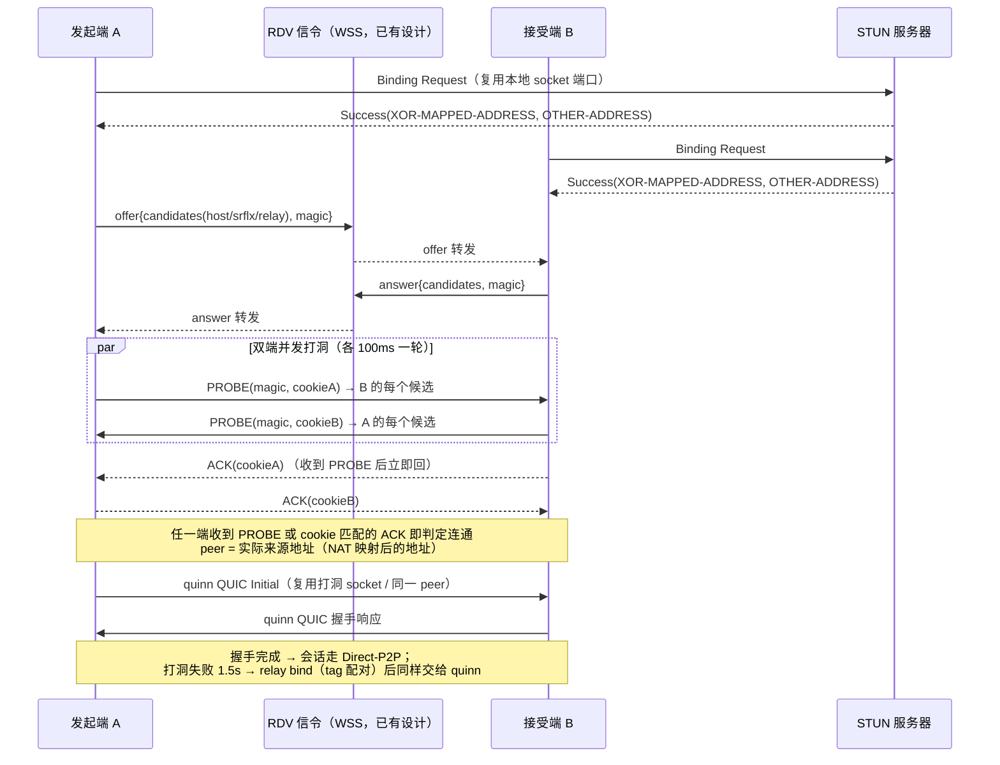

# 023 · P2P 打洞（STUN 子集 + 候选收集 + 双端并发 punch）

> 业主 §17：**P2P 优先，中继兜底**。本文是 `crates/dfy-p2p` 的设计与实现说明：
> clean-room 自研（不引入 webrtc/stun 现成实现），只做打洞必需的那一层——
> STUN 探测、候选枚举与排序、双端并发打洞，成功后把**已连通的 UDP socket** 交给
> `dfy-transport` 的 quinn `Endpoint`。信令交换、TLS/QUIC 握手、质量检测与迁移
> 分别在 RDV（见 `021`/`022`）、`dfy-transport`、`dfy-session`（见 `013` §4）里。
>
> 上游约束见 `design/013-relay-and-p2p.md` §3：双方交换候选 → 并发打洞 → 失败 1.5s
> 回退 relay；对称 NAT 直接走 relay。

## 1. 目标与非目标

### 1.1 目标

| # | 目标 | 落地 |
|---|---|---|
| G1 | RFC 5389 子集：Binding Request/Response、XOR-MAPPED-ADDRESS、CHANGE-REQUEST、RESPONSE-ORIGIN / OTHER-ADDRESS，事务 ID 随机，超时重传 | `crates/dfy-p2p/src/stun.rs` |
| G2 | 候选枚举：Host（本机 socket 地址）/ ServerReflexive（STUN 映射）/ Relay（兜底，由中继层追加），按 RFC 8445 优先级排序去重 | `crates/dfy-p2p/src/candidate.rs` |
| G3 | 双端并发打洞：同时向对端所有候选发 UDP punch 包，收到对方包即成功；返回连通的 socket + 对端**真实**地址 | `crates/dfy-p2p/src/punch.rs` |
| G4 | 门面 API + 自测（回环 STUN 服务器、双端打洞、NAT 判定） | `src/lib.rs`、`tests/p2p_loopback.rs` |
| G5 | 零 C 依赖、零 `unsafe`、不引入 `windows`/webrtc/stun 大 crate | `Cargo.toml` + `#![forbid(unsafe_code)]` |

### 1.2 非目标（明确不在本 crate）

- ICE 全栈（ufrag/pwd、trickle ICE、候选 pair 状态机、ICE restart）；
- TURN/中继数据面（属于 `dfy-relay`，见 `013` §2）；
- 信令（候选经 RDV/WSS 交换，属于 `dfy-proto` + 会话层）；
- QUIC/TLS 握手与身份校验（属于 `dfy-transport`）；
- `MESSAGE-INTEGRITY` 的 HMAC 校验（结构预留，见 §3.5）；
- IPv6 主路径、多网卡全枚举、mDNS 局域网发现（待办 §10）。

## 2. crate 结构与公开 API

```
crates/dfy-p2p/
├── Cargo.toml            # 仅 anyhow/rand/tokio/tracing（workspace 继承）
├── src/
│   ├── lib.rs            # 门面：模块导出 + gather_for_punch / gather_and_punch
│   ├── stun.rs           # RFC 5389/5780 子集 + 重传 + 响应解析
│   ├── candidate.rs      # 候选类型/优先级/收集/srflx/NatHint
│   └── punch.rs          # 打洞帧、PunchOptions、punch()、P2PSession
└── tests/
    └── p2p_loopback.rs   # 最小 STUN 服务器 + 端到端回环测试
```

### 2.1 公开 API 签名

```rust
// ---- stun ----
pub const MAGIC_COOKIE: u32 = 0x2112_A442;
pub const HEADER_LEN: usize = 20;
pub const TRANSACTION_ID_LEN: usize = 12;
pub const MAX_STUN_ATTEMPTS: u32 = 4;              // 首发 1 次 + 重传 3 次
pub const MIN_STUN_RETRANSMIT: Duration = 100ms;
pub const DEFAULT_STUN_TIMEOUT: Duration = 2s;

pub struct StunResult {
    pub mapped: SocketAddr,        // XOR-MAPPED-ADDRESS
    pub other: Option<SocketAddr>, // OTHER-ADDRESS
    pub source: SocketAddr,        // 实际回包来源（判定 NAT 过滤行为）
    pub rtt: Duration,
}

pub async fn stun_probe(server: SocketAddr, timeout: Duration) -> Result<StunResult>;
pub async fn stun_probe_with_change(
    server: SocketAddr, timeout: Duration, change: ChangeFlags,
) -> Result<StunResult>;
pub async fn stun_probe_on_socket(
    socket: &UdpSocket, server: SocketAddr, timeout: Duration,
) -> Result<StunResult>;
pub async fn stun_probe_on_socket_with_change(
    socket: &UdpSocket, server: SocketAddr, timeout: Duration, change: ChangeFlags,
) -> Result<StunResult>;

pub struct StunMessage { pub msg_type: u16, pub transaction_id: [u8; 12], pub attributes: Vec<RawAttribute> }
impl StunMessage {
    pub fn new(msg_type: u16, transaction_id: [u8; 12]) -> Self;
    pub fn binding_request(transaction_id: [u8; 12]) -> Self;
    pub fn binding_success(txid: [u8; 12], mapped: SocketAddr, other: Option<SocketAddr>) -> Self;
    pub fn binding_error(txid: [u8; 12], code: u16, reason: &str) -> Self;
    pub fn encode(&self) -> Vec<u8>;
    pub fn decode(bytes: &[u8]) -> Result<Self>;
    pub fn xor_mapped_address(&self) -> Result<Option<SocketAddr>>;
    pub fn other_address(&self) -> Result<Option<SocketAddr>>;
    pub fn response_origin(&self) -> Result<Option<SocketAddr>>;
    pub fn change_request(&self) -> Option<u32>;
    pub fn error_code(&self) -> Option<(u16, String)>;
    // …属性构造器：xor_mapped_address_attribute / response_origin_attribute / change_request_attribute 等
}
pub fn random_transaction_id() -> [u8; 12];   // 96 bit 随机，首字节最高位清零
pub fn encode_message_type(method: u16, class: MessageClass) -> u16;
pub fn decode_message_type(msg_type: u16) -> (u16, MessageClass);

// ---- candidate ----
pub enum CandidateKind { Host, ServerReflexive, Relay }   // type preference 126 / 100 / 0
pub struct Candidate { pub kind: CandidateKind, pub addr: SocketAddr, pub priority: u32 }
pub enum NatHint { Unknown, ConsistentMapping, InconsistentMapping }
pub struct GatheredCandidates {
    pub candidates: Vec<Candidate>,
    pub socket: UdpSocket,     // 打洞必须复用同一 socket/端口
    pub local_port: u16,
    pub nat_hint: NatHint,
}

pub fn candidate_priority(kind: CandidateKind, local_preference: u16, component_id: u16) -> u32;
pub fn sort_candidates(candidates: &mut [Candidate]);
pub fn dedup_and_sort(candidates: impl IntoIterator<Item = Candidate>) -> Vec<Candidate>;
pub fn gather_local_candidates(local_port: u16) -> Vec<SocketAddr>;
pub fn bind_udp_socket(port: u16) -> Result<UdpSocket>;
pub async fn gather_candidates(
    stun_servers: &[SocketAddr], local_port: u16, stun_timeout: Duration,
) -> Result<Vec<Candidate>>;
pub async fn gather_with_socket(
    stun_servers: &[SocketAddr], local_port: u16, stun_timeout: Duration,
) -> Result<GatheredCandidates>;

// ---- punch ----
pub const PUNCH_FRAME_LEN: usize = 13;
pub const PUNCH_MAGIC: [u8; 4] = *b"DFYP";
pub const DEFAULT_PUNCH_DEADLINE: Duration = 1500ms;
pub const DEFAULT_PUNCH_INTERVAL: Duration = 100ms;

pub struct PunchOptions { pub deadline: Duration, pub interval: Duration, pub magic: [u8; 4] }
pub struct P2PSession { pub socket: std::net::UdpSocket, pub peer: SocketAddr }

pub async fn punch(
    local: std::net::UdpSocket,
    remote_candidates: &[SocketAddr],
    opts: PunchOptions,
) -> Result<P2PSession>;

// ---- lib 门面 ----
pub struct PunchOutcome {
    pub session: P2PSession, pub candidates: Vec<Candidate>,
    pub nat_hint: NatHint, pub local_port: u16,
}
pub async fn gather_for_punch(stun_servers: &[SocketAddr], local_port: u16, stun_timeout: Duration)
    -> Result<GatheredCandidates>;
pub async fn gather_and_punch(
    stun_servers: &[SocketAddr], remote_candidates: &[SocketAddr], local_port: u16,
    stun_timeout: Duration, opts: PunchOptions,
) -> Result<PunchOutcome>;
```

## 3. STUN 消息格式（RFC 5389 子集）

### 3.1 报文头（20 字节，网络序）

| 字段 | 位宽 | 说明 |
|---|---|---|
| Message Type | 14 bit（占前 2 字节低 14 位） | 方法号 + 类别（见 3.2） |
| Message Length | 16 bit | 头部之后（属性区）字节数，**不含** 20 字节头，必须是 4 的倍数 |
| Magic Cookie | 32 bit | 固定 `0x2112A442`（本实现常量 `MAGIC_COOKIE`） |
| Transaction ID | 96 bit | 每事务随机；请求方生成，响应原样回带；最高位清零（RFC 5389 §6） |

### 3.2 消息类型编码

14 位里 `M11..M0` 是 12 bit 方法号，`C1 C0` 是 2 bit 类别，**C1 插在最高位、C0 插在方法号最高位之前**：

```
 0                 1
 2 3 4 5 6 7 8 9 0 1 2 3 4 5
+--+--+-+-+-+-+-+-+-+-+-+-+-+-+
|M |M |M|M|M|M|M|M|M|M|C|M|M|M|
|11|10|9|8|7|6|5|4|3|2|1|0|C|0|
+--+--+-+-+-+-+-+-+-+-+-+-+-+-+
```

`type = (method & 0x0F80) << 2 | (method & 0x0070) << 1 | (method & 0x000F) | class_bits << 4`
（`class_bits`：`0b00` Request、`0b01` Indication、`0b10` Success、`0b11` Error）。

| 名称 | 值 | 用途 |
|---|---|---|
| Binding Request | `0x0001` | 客户端 → 服务器 |
| Binding Indication | `0x0011` | 保留（本期不发） |
| Binding Success Response | `0x0101` | 服务器 → 客户端 |
| Binding Error Response | `0x0111` | 服务器 → 客户端（如 400/420） |

### 3.3 属性表（TLV：`type u16 | length u16 | value | padding`，padding 补到 4 字节）

| 属性 | type | 方向 | 本实现 |
|---|---|---|---|
| `MAPPED-ADDRESS` | `0x0001` | 响应 | 解析（兼容旧服务器），构造 |
| `CHANGE-REQUEST` | `0x0003` | 请求 | 构造 + 解析（RFC 5780，bit2=换 IP、bit1=换端口） |
| `MESSAGE-INTEGRITY` | `0x0008` | both | **原样保留，不校验**（见 3.5） |
| `ERROR-CODE` | `0x0009` | 错误响应 | 构造 + 解析（code 拆分 + reason UTF-8） |
| `XOR-MAPPED-ADDRESS` | `0x0020` | 响应 | 核心：构造 + 解析，IPv4/IPv6 |
| `SOFTWARE` | `0x8022` | 请求/响应 | 常量保留（本期不发） |
| `FINGERPRINT` | `0x8028` | both | 常量保留，不校验 |
| `RESPONSE-ORIGIN` | `0x802b` | 响应 | 构造 + 解析（RFC 5780） |
| `OTHER-ADDRESS` | `0x802c` | 响应 | 构造 + 解析（RFC 5780，用于 NAT 行为探测） |

### 3.4 XOR-MAPPED-ADDRESS 的 XOR 规则

- IPv4：`port' = port XOR (cookie >> 16)`；`ip' = ip XOR cookie`；value = `0x00 | family(0x01) | port'(2B) | ip'(4B)`；
- IPv6：`port'` 同上，`ip' = ip XOR (cookie || transaction_id)`（16 字节），family = `0x02`；
- `MAPPED-ADDRESS` / `OTHER-ADDRESS` / `RESPONSE-ORIGIN` **不做 XOR**。

### 3.5 MESSAGE-INTEGRITY（结构预留，未实现校验）

- `RawAttribute` 原样保留任何属性，`message_integrity()` 返回属性值切片，`encode/decode` 不破坏它；
- 未做 HMAC-SHA1 校验（项目约束不新增依赖；`sha1` 不在锁文件里，且认证属于短期/长期凭证方案，需要与信令设计一起定）；
- 待办见 §10：`hmac` + `hmac-sha1`（纯 Rust）实现校验 + `USERNAME`/`REALM`/`NONCE`，防止开放 STUN 被滥用。

### 3.6 探测与重传策略（`stun_probe*`）

1. `bind_probe_socket`：按服务器地址族绑定 `0.0.0.0:0` / `[::]:0`；`stun_probe_on_socket` 用 `try_clone` 复用调用方端口（保证 srflx 与实际打洞端口一致）。
2. 置非阻塞 → `tokio::net::UdpSocket::from_std`。
3. 循环最多 `MAX_STUN_ATTEMPTS = 4` 次（1 首发 + 3 重传）：每次生成新随机事务 ID（重传**换 ID**，简化匹配），发送 Binding Request（可带 CHANGE-REQUEST）。
4. 每次等待 `per_attempt = max(timeout / 4, 100ms)`，整体受 `timeout` 约束。
5. 按事务 ID 匹配响应；**接受任意源地址**的回包（CHANGE-REQUEST 要求回包来自另一地址）；忽略无法解析/ID 不匹配/非 Success 的包；`Error Response` 立即报错。
6. 解析 `XOR-MAPPED-ADDRESS`（回退 `MAPPED-ADDRESS`）与 `OTHER-ADDRESS`，记录 `source` 与 `rtt`。
7. 全部失败返回 `anyhow::Error`，错误文本含服务器地址与最后一次超时说明；调用方据此决定回退 relay。

UDP 层的瞬时错误（`WouldBlock`、Windows 上 ICMP 端口不可达导致的 `ConnectionReset` 等）只记 `trace` 并继续重试，不当作失败。

## 4. 打洞帧与状态机

### 4.1 帧格式（13 字节，刻意与 QUIC/常见协议区分）

| 偏移 | 长度 | 字段 | 说明 |
|---|---|---|---|
| 0 | 4 | `magic` | 默认 `DFYP`；可由信令派生的会话盐覆盖（`PunchOptions::with_magic`） |
| 4 | 1 | `kind` | `1` = PROBE，`2` = ACK |
| 5 | 8 | `cookie` | 发送方随机 8 字节；ACK 原样回带收到的 PROBE 的 cookie |

长度不是 13 字节、或 magic 不匹配的包一律忽略（quinn 也会丢弃非 QUIC 报文）。

### 4.2 状态机

```
Idle ──► Probing ──(收到 PROBE)──► 回 ACK ──► Connected
              │
              ├──(收到 cookie 匹配的 ACK)────────► Connected
              └──(deadline 到期)─────────────────► Failed(→ relay)
```

规则：
- 每 `interval`（默认 100ms）向**所有**候选各发一个 PROBE；单个候选发送失败不致命；
- 收到对端 PROBE = 双向可达（我们确实收到了它）→ 先尽力回 ACK（对方 PROBE 可能全丢），随即成功；
- 收到 ACK 且 cookie 等于本端 PROBE cookie → 成功（防止陈旧包/伪造包误判）；
- 成功时返回本端 socket 与**实际来源地址** `peer`（即对端 NAT 映射后的地址，不一定是候选表里的地址）；
- 失败返回 `打洞超时（…，候选 N 个），应回退 relay`，调用方切 relay。

### 4.3 socket 生命周期

`punch(local: std::net::UdpSocket, …)` 要求 `local` 是收集候选/STUN 探测用过的**同一个 socket**（端口必须一致，否则 NAT 映射不同，打洞必失败）。流程：

`set_nonblocking(true)` → `tokio::net::UdpSocket::from_std` → 打洞 → `into_std()` 还原 → 返回 `P2PSession`。返回的 socket 保持**非阻塞**，可直接交给 quinn（见 §7）。

## 5. 候选枚举与优先级

### 5.1 类型与优先级（RFC 8445 §5.1.2）

```
priority = (2^24 × type_preference) + (2^8 × local_preference) + (256 - component_id)
type_preference: Host=126, ServerReflexive=100, Relay=0
local_preference 默认 65535；component_id 默认 1（单条 QUIC 连接）
```

默认值（便于断言/日志）：Host `0x7EFF_FFFF`、srflx `0x64FF_FFFF`、relay `0x00FF_FFFF`。

排序：优先级降序 → 类型优先 → 地址稳定排序；`dedup_and_sort` 对同一 `addr` 只保留优先级最高的一条。

### 5.2 Host 候选（本机地址）——已知局限

纯 std 实现：对 `8.8.8.8:80` / `1.1.1.1:53` / `192.168.1.1:80` 依次 `UdpSocket::bind(0.0.0.0:0)` + `connect()`，读取 `local_addr()` 的 IPv4 源地址（UDP connect 只在本地路由表选源地址、**不发包**）。

局限（设计取舍，不引入 `windows` crate 避免重依赖）：
- 只能发现**默认路由出口的那一个 IPv4 地址**；多网卡/多出口/隧道场景候选不全；
- 无线 + 有线同时在线、VPN 拆分路由时可能拿到非预期出口；
- 无默认路由（离线）返回空列表，调用方只依赖 srflx/relay，不得返回 `0.0.0.0` 占位；
- IPv6 Host 候选本期不收集（QUIC 仍可用 srflx v4 路径）。

替代方案（待办 P1）：`GetAdaptersAddresses`（`windows`/`windows-sys` 仅在该 crate 内使用）或调用系统 `ipconfig` 解析；信令层也可由对端/RDV 补充 Host 候选（prflx）。

### 5.3 srflx 候选与 NAT 判定

`gather_with_socket` 绑定 `0.0.0.0:local_port`（`0` = 内核分配）→ 置非阻塞 → 对每个 STUN 服务器 `stun_probe_on_socket`（复用同一端口）→ 成功则加 srflx 候选。

`NatHint`（多服务器映射一致性）：

| 成功服务器数 | 映射地址情况 | NatHint | 含义 |
|---|---|---|---|
| < 2 | — | `Unknown` | 无法判定（默认） |
| ≥ 2 | 全部相同 | `ConsistentMapping` | 映射与目的无关（full/restricted cone 倾向），打洞成功率高 |
| ≥ 2 | 出现不同 | `InconsistentMapping` | 疑似对称 NAT，srflx 打洞基本无效 → **直接 relay** |

`GatheredCandidates::suggests_relay()`：`InconsistentMapping` 或候选里没有任何 Host/srflx（只剩 relay）时为 `true`。

relay 候选（type=Relay，优先级最低）不在本 crate 生成，由会话层在 relay bind 成功后追加（`Candidate::relay(addr)`）。

## 6. NAT 类型与失败回退策略

### 6.1 四类 NAT 下的行为

| NAT 类型 | 映射行为 | 过滤行为 | 打洞结果 | 本 crate 判定 |
|---|---|---|---|---|
| Full Cone | 与目的无关 | 任何外部地址可入 | 通常成功（一端即可） | 多 STUN 映射一致 |
| Restricted Cone | 与目的无关 | 仅允许**已出站过的 IP** 入 | 双端同时发即可成功（限制端口不限制） | 映射一致 |
| Port-Restricted Cone | 与目的无关 | 仅允许已出站过的 IP:端口 入 | 双端**同时**发，多数成功（本实现正是并发发） | 映射一致 |
| Symmetric | 每个目的映射不同 | 只接受已出站目的 | 对 srflx 打洞基本失败 | 多 STUN 映射不同 / 探测回包源不同 |

补充探测手段（RFC 5780，`stun_probe_with_change`）：
- 带 `CHANGE-REQUEST(change_ip|change_port)` 探测：若服务器从**另一 IP/端口**回包且客户端能收到 → 过滤宽松（full cone 倾向）；超时 → 有过滤（restricted 以上）。`StunResult::source` 记录实际回包源，`other` 提供备用地址。
- 仅换端口（`change_port`）能收到、换 IP 收不到 → 端口受限；两者都收不到 → 地址/端口双重过滤。

### 6.2 决策树（会话层调用顺序）

```
gather_with_socket(stun_servers, local_port)
   ├─ nat_hint == InconsistentMapping ─────────────► 跳过打洞，直接 relay
   ├─ 远端候选为空 ──────────────────────────────► relay
   └─ 否则 punch(local.socket, remote_candidates, PunchOptions{deadline:1500ms})
          ├─ 成功 ──► 把 session.socket/peer 交给 quinn，走 Direct-P2P
          └─ 失败 ──► relay（1.5s 预算已用完，不再重试；见 013 §3）
```

- 预算：`DEFAULT_PUNCH_DEADLINE = 1.5s`，与 `013` 的「失败 1.5s → relay」一致；发包间隔 100ms，最多约 15 轮 × N 候选；
- 对称 NAT：不浪费 1.5s，`NatHint` 判定后直接 relay（`013` §3 第 3 条）；
- relay 路径的 socket/端点由 `dfy-relay` 提供，仍走 `dfy-transport::connect_on_socket` / `agent_endpoint_on_socket`（§7）；
- 失败后回切：P2P 质量监测与迁移属于 `dfy-session`（`013` §4），本 crate 不感知；
- 打洞期间瞬时 ICMP 错误忽略；连续发送失败不单独报错，统一以 deadline 收尾。

## 7. 打洞时序图



时序要点：

1. **同一 socket**：STUN、打洞、quinn 共用一个 UDP socket/端口，NAT 映射才有效；这也是 `gather_with_socket` 返回 socket 而不是端口的原因。
2. **双端同时发**：端口受限 NAT 要求双向都先出站；单端等待必失败。
3. **成功判据来自收包**：`peer` 用实际来源地址，而不是候选地址——候选可能是过期的/被 NAT 改写的；对端真实地址可作为 prflx 候选回传信令（待办 §10）。
4. **残包无害**：打洞阶段互回的 ACK 若在 quinn 接管后到达，会因不是 QUIC 报文被丢弃；需要干净队列时可先 drain（见 §8.2）。

## 8. 与 `dfy-transport` 的对接点

### 8.1 接口事实（已存在）

```rust
// crates/dfy-transport/src/endpoint.rs
pub fn agent_endpoint_on_socket(socket: std::net::UdpSocket, identity: TlsIdentity) -> Result<Endpoint>;
pub async fn connect_on_socket(
    socket: std::net::UdpSocket, tls: ClientTls, peer: SocketAddr,
) -> Result<(Endpoint, Connection)>;
```

两者都把 `std::net::UdpSocket` 直接交给 `quinn::Endpoint::new(..., Arc::new(quinn::TokioRuntime))`，**要求 socket 已绑定且非阻塞**。`punch` 返回的 `P2PSession.socket` 恰好满足：绑定在候选收集端口、非阻塞、已与对端互联。

依赖方向：`dfy-p2p` **不依赖** `dfy-transport`（保持底层无环）；由 `dfy-session` / `dfy-cli` 组合两者。

### 8.2 发起端（client）示例

```rust
use dfy_p2p::{gather_and_punch, PunchOptions};

let outcome = gather_and_punch(
    &stun_servers,            // 用户配置的 STUN 列表
    &remote_candidates,       // 信令收到的对端候选（SocketAddr）
    0,                        // 本地端口：0 = 内核分配
    Duration::from_secs(2),
    PunchOptions::default(),  // deadline 1.5s / interval 100ms / magic
).await?;

let dfy_p2p::PunchOutcome { session, nat_hint, .. } = outcome;
let dfy_p2p::P2PSession { socket, peer } = session;
// socket 已非阻塞；peer 是对端真实地址
let (endpoint, connection) =
    dfy_transport::connect_on_socket(socket, tls, peer).await?;
```

### 8.3 接受端（agent）示例

```rust
// 接受端同样先 gather + punch（双方必须同时进行，否则端口受限 NAT 打不通）
let (socket, peer) = /* punch(...)? .into_parts() */;
let endpoint = dfy_transport::agent_endpoint_on_socket(socket, identity)?;
// 之后 endpoint.accept().await 拿连接；QUIC 会对 peer 做 TLS 指纹校验
```

### 8.4 relay 兜底使用同一组函数

relay 模式下 socket 来自 `dfy-relay` 的 tag 配对（见 `022`），`peer` 设为中继端点地址，同样调用 `connect_on_socket` / `agent_endpoint_on_socket`——两条路径对 `dfy-transport` 完全同构，上层只需切换端口/地址来源。

### 8.5 残包清理（可选）

```rust
// 若担心打洞 ACK 影响首包统计：把 socket 临时包成 tokio UdpSocket，
// 以 50ms 空闲为界 drain 掉残留的 13 字节帧，再转为 std 交给 quinn。
```

`tests/p2p_loopback.rs` 即采用该做法验证业务数据互通。

## 9. 自测覆盖矩阵

| 层 | 测试 | 覆盖内容 |
|---|---|---|
| 单元（`stun.rs`，11 个） | 类型编解码往返、v4/v6 XOR 往返、OTHER/RESPONSE-ORIGIN、CHANGE-REQUEST、MESSAGE-INTEGRITY 保留、ERROR-CODE、畸形头/截断属性拒绝、未知属性保留、随机事务 ID | 纯函数正确性 |
| 单元（`candidate.rs`，7 个） | 优先级公式/默认值、排序、去重、Host 端口、无 STUN 收集、suggests_relay | 候选逻辑 |
| 单元（`punch.rs`，8 个） | 帧编解码/拒绝、参数校验、双端回环打洞+数据互通、静默超时、仅 ACK 路径、不可达候选 | 打洞核心 |
| 集成（`tests/p2p_loopback.rs`，6 个） | 回环 STUN 服务器：mapped == 服务器观察源、RTT<2s、OTHER-ADDRESS、丢 2 包后重传成功、静默超时、CHANGE-REQUEST 0x06 且回包换端口、gather 的 socket 复用打洞+双向业务数据、不可达候选超时 | 端到端 |

**回环测试能证明**：报文格式与解析、事务 ID 匹配、重传、候选复用同一端口、双端并发打洞协议、成功后 socket 可直接收发业务数据。

**回环测试不能证明**（单机无真实 NAT/公网，必须在真实环境人工验证）：
- 真实公网 STUN 服务器（如 `stun.l.google.com:19302`）的响应与 RTT；
- 真实 NAT 的映射/过滤行为、对称 NAT 判别准确率；
- 跨机器、跨网段、跨运营商、IPv6、双栈；
- 企业防火墙/DPI 对 13 字节打洞帧与 QUIC 的处置；
- `deadline/interval` 在网络 RTT > 100ms 时的调参效果。

人工验证命令（开发机联网时）：

```powershell
# 1) 公网 STUN 探测（项目内可用示例/小工具或集成测试改造）
#    预期 mapped == 本机公网出口 IP:port，rtt 为真实 RTT
# 2) 两台不同 NAT 后的机器交换候选并打洞，观察 tracing 日志
#    "开始 UDP 打洞" → "UDP 打洞成功" / "UDP 打洞超时"
```

## 10. 局限与待办

### 10.1 已知局限（本期）

1. **无真实 NAT/公网验证**：仅回环集成测试，见 §9；对称 NAT 判定逻辑正确性待实地校准。
2. **MESSAGE-INTEGRITY 未校验**：结构预留；开放 STUN 服务器可能拒绝无认证请求（420）或存在滥用风险。
3. **打洞帧未认证**：默认 magic 公开，理论上攻击者知道候选地址后可注入 PROBE 让本端"打洞成功"到攻击者地址；但随后 QUIC/TLS 身份校验会失败（回落 relay/重试），不会泄露明文。加固见 10.2-4。
4. **Host 候选只枚举默认出口 IPv4**：多网卡/多出口/VPN 场景不全（§5.2）。
5. **IPv6 仅 STUN 报文层支持**：候选收集与打洞主路径按 IPv4 设计。
6. **单候选串行发送**：所有候选每轮都发，无 RTT 学习/退避；候选多时包量线性增长。
7. **无 prflx 候选回传**：打洞成功后拿到的 `peer` 未回传信令，后续重连仍靠旧候选。
8. **无 NAT 映射保活**：依赖 quinn 的 PING/keep-alive 维持映射；长空闲后映射可能过期。
9. **无 ICE 的候选 pair 状态机**：不做 per-pair 优先级/RTT 探测，等价 ICE-lite 的简化版。
10. **`gather_local_candidates` 不做网卡过滤**：虚拟网卡/回环之外的出口由路由表决定。

### 10.2 待办（按优先级）

| 优先级 | 事项 |
|---|---|
| P0 | 真实环境验证：公网 STUN、跨 NAT 打洞、对称 NAT 误判率；据实调 `deadline/interval` 与 `NatHint` 阈值 |
| P0 | 与 `dfy-session` 打通：候选信令（offer/answer）、relay 回退编排、P2P 质量监测与迁移（`013` §4） |
| P1 | 打洞帧加固：`magic` 由会话盐派生（`PunchOptions::with_magic` 已预留）+ 要求双向 cookie 确认后才返回成功，或引入短期 `ufrag/pwd` 认证 |
| P1 | `MESSAGE-INTEGRITY` + `FINGERPRINT`：纯 Rust `hmac`/`sha1` 实现校验，支持短期/长期凭证 |
| P1 | 多网卡 Host 枚举：`GetAdaptersAddresses`（`windows-sys`，仅在本 crate 内）或信令补充 |
| P1 | 候选 pair 并行探测与早停：按优先级/RTT 选择候选，减少包量与 1.5s 内成功率 |
| P2 | IPv6 主路径（双栈 socket、候选去重） |
| P2 | prflx 候选回传、NAT 保活心跳、ICE restart |
| P2 | 局域网 mDNS/广播发现（`013` §3 第 4 条，P1 级但非打洞层） |

## 11. 附：一次 Binding 交换的字节级示例

请求（无属性，20 字节，事务 ID 全 `0x11`）：

```
00 01 00 00 21 12 A4 42 11 11 11 11 11 11 11 11 11 11 11 11
└type┘ └len┘ └cookie┘ └──────────── transaction id ───────────┘
```

成功响应（XOR-MAPPED-ADDRESS = `192.0.2.33:54321`，即 `0xC0000221:0xD431`）：

```
01 01 00 0C 21 12 A4 42 <transaction id 12B>
00 20 00 08 00 01 <port^0x2112> <ip^0x2112A442>
└attr┘ └len┘ └fam┘ └── value ──┘
port' = 0xD431 ^ 0x2112 = 0xF523；ip' = 0xC0000221 ^ 0x2112A442 = 0xE112A663
```