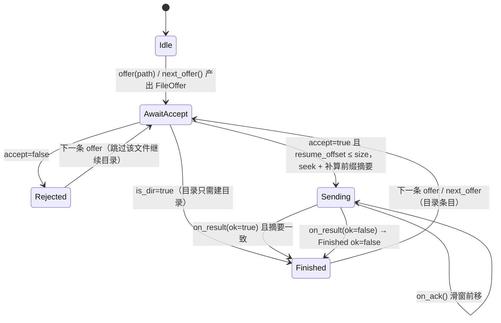
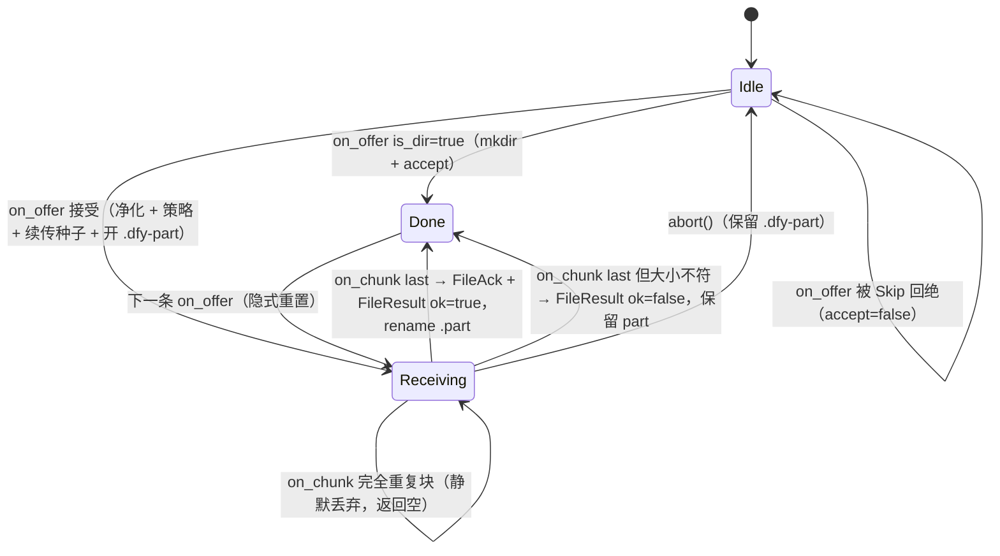

# 024 · 文件传输（offer/accept/chunk/ack/result 状态机 + 断点续传）

> 业主 §3.4：**P0 文件传输（拖拽、进度、断点续传）**。本文是 `crates/dfy-files` 的设计与
> 实现说明：协议帧已在 `crates/dfy-proto/src/msg.rs`（tag 17–21）定义，本 crate 只做
> 「收到一条消息 → 推进状态 → 产出下一条消息」，**不持有 QUIC 连接、不做异步 I/O**，
> 因而可以用真文件在纯同步单测里跑完整条链路。
>
> 上游约束见 `spec/DFYP-v1.md` §9：v1 复用 control 流上的 tag 17–21；块 ≤ 256 KiB；
> 每 16 MiB / 64 块回一次 `FileAck`；目录先建；`OVERWRITE/SKIP/RENAME` 策略；
> 先写 `.dfy-part` 再 rename（原子落盘）；整文件 BLAKE3；续传以接收端实际长度为准。
>
> 下游待接：`dfy-session` 的 `CtrlHandler` 缝（`crates/dfy-session/src/agent.rs:40`）与 CLI 的
> `dfy agent` / `dfy view` 两条生命周期（§9）。

## 1. 目标与非目标

### 1.1 目标

| # | 目标 | 落地 |
|---|---|---|
| G1 | 协议映射完整：`FileOffer/FileAccept/FileChunk/FileAck/FileResult` ↔ `Envelope::file_*` | `src/sender.rs`、`src/receiver.rs` |
| G2 | 发送端状态机：offer → accept/resume → 分块发送（在途窗口背压）→ ack → result | `src/sender.rs` |
| G3 | 接收端状态机：净化路径 → 策略 → 续传种子 → 落盘 → 收尾（ack + result） | `src/receiver.rs` |
| G4 | 路径安全：拒绝 `..`/绝对路径/盘符/UNC/Windows 保留名/符号链接逃逸 | `src/path.rs` |
| G5 | 目录递归：确定性顺序展开、先建目录、空目录也传输、跳过符号链接/特殊文件 | `src/plan.rs` |
| G6 | 断点续传：以已落盘长度为起点；发送端流式补算前缀 BLAKE3，摘要始终覆盖整文件 | `src/sender.rs::open_and_hash_prefix`、`src/receiver.rs::seed_part` |
| G7 | 原子落盘与损坏检测：`.dfy-part` + BLAKE3 整文件校验 → rename；失败保留 part | `src/receiver.rs::on_chunk` |
| G8 | 防御性配置：单块/单文件大小上限、发射窗口、ack 间隔可调 | `src/receiver.rs::ReceiveConfig`、`src/sender.rs::SenderConfig` |
| G9 | 测试与文档：单测 + 端到端（同进程内存泵）+ crate 级文档 | `tests/e2e_transfer.rs`、本文件 |

### 1.2 非目标（明确不在本 crate）

- QUIC/TLS 收发、控制流复用与心跳（属于 `dfy-transport` / `dfy-session`，见 `013`）；
- v1 之外的 `file-meta` / `file-data` 独立单向流（`spec/DFYP-v1.md` §9 末段，见 §10 待办）；
- UI/拖拽/进度条/剪贴板文件列表（属于 `dfy-cli` 前端，见 §9）；
- 时间戳/权限位/ACL/ADS（备用数据流）保留：v1 只尽力还原 `last_modified_ms`（当前**不**落盘 mtime，见 §10）；
- 压缩、目录打包、大文件 FTP 通道（产品 §3.4 的 P2/P1 项）；
- 多文件并行：v1 发送端同一时刻只推进一个 `transfer_id`，目录条目串行（协议本身允许多 ID，见 §4.4）。

## 2. crate 结构与公开 API

```
crates/dfy-files/
├── Cargo.toml              # dfy-proto + blake3 + hex + thiserror + tracing；dev: tempfile
├── src/
│   ├── lib.rs              # 门面：模块导出、默认常量、part_path()
│   ├── error.rs            # FileError（可判别变体 + io/invalid 助手）
│   ├── path.rs             # 路径净化 + 逐级 resolve_within（拒绝符号链接逃逸）
│   ├── plan.rs             # 目录递归展开为确定序清单（跳过 symlink/特殊文件）
│   ├── sender.rs           # FileSender 状态机
│   └── receiver.rs         # FileReceiver 状态机（策略/续传/原子落盘）
└── tests/
    └── e2e_transfer.rs     # 同进程「内存泵」端到端：Envelope 在两端之间搬运
```

门面常量（`src/lib.rs`）：

```rust
pub const DEFAULT_CHUNK_BYTES: usize = 256 * 1024;     // 协议建议块大小
pub const DEFAULT_ACK_BYTES: u64 = 16 * 1024 * 1024;   // 每 16 MiB 回 ack
pub const DEFAULT_ACK_CHUNKS: u32 = 64;                // 或每 64 块回 ack
pub const DEFAULT_IN_FLIGHT_BYTES: u64 = 16 * 1024 * 1024; // 发送端未确认窗口
pub const DIGEST_BYTES: usize = 32;                    // BLAKE3 = 32B
pub const PART_SUFFIX: &str = ".dfy-part";             // 临时文件后缀
```

公开 API 签名（节选，`pub` 全量见 rustdoc）：

```rust
// ---- path ----
pub fn sanitize_relative_path(raw: &str) -> Result<String, FileError>;
pub fn sanitize_file_name(raw: &str) -> Result<String, FileError>;

// ---- plan ----
pub struct DirEntryPlan { pub relative: String, pub size: u64, pub is_dir: bool, pub last_modified_ms: u64 }
pub struct PlanOptions { pub skip_hidden: bool }
pub fn plan_directory(path: &Path) -> Result<Vec<DirEntryPlan>, FileError>;
pub fn plan_directory_with(path: &Path, opts: PlanOptions) -> Result<Vec<DirEntryPlan>, FileError>;

// ---- sender ----
pub struct SenderConfig { pub max_chunk_bytes: usize, pub in_flight_bytes: u64 }
pub struct FileTransferStats { pub bytes_sent: u64, pub chunks_sent: u64,
                               pub resumed_from: u64, pub digest: Option<[u8; 32]> }
impl FileSender {
    pub fn new(transfer_id_base: u64) -> Self;
    pub fn with_config(transfer_id_base: u64, config: SenderConfig) -> Self;
    pub fn offer(&mut self, path: &Path) -> Result<FileOffer, FileError>;
    pub fn next_offer(&mut self) -> Result<Option<FileOffer>, FileError>;
    pub fn on_accept(&mut self, accept: &FileAccept) -> Result<Vec<Envelope>, FileError>;
    pub fn next_chunk(&mut self, max_bytes: usize) -> Result<Option<Envelope>, FileError>;
    pub fn on_ack(&mut self, ack: &FileAck);
    pub fn on_result(&mut self, result: &FileResult) -> Result<(), FileError>;
    // stats / is_complete / is_rejected / is_failed / is_blocked_on_ack /
    // in_flight_bytes / transfer_id / pending_len / clear_pending
}

// ---- receiver ----
pub enum OverwritePolicy { Overwrite, Skip, Rename }        // default = Skip
pub struct ReceiveConfig { pub ack_bytes: u64, pub ack_chunks: u32,
                           pub max_chunk_bytes: usize, pub max_file_bytes: u64 }
pub struct FileReceiveStats { pub bytes_received: u64, pub chunks_received: u64,
    pub acked_bytes: u64, pub resumed_from: u64, pub digest: Option<[u8; 32]>,
    pub files_completed: u64, pub dirs_created: u64, pub bytes_total: u64 }
impl FileReceiver {
    pub fn new(root: PathBuf, policy: OverwritePolicy) -> Self;
    pub fn with_config(root: PathBuf, policy: OverwritePolicy, config: ReceiveConfig) -> Self;
    pub fn on_offer(&mut self, offer: &FileOffer) -> Result<(FileAccept, PathBuf), FileError>;
    pub fn on_chunk(&mut self, chunk: &FileChunk) -> Result<Vec<Envelope>, FileError>;
    pub fn abort(&mut self);   // 保留 .dfy-part 供续传
    // stats / root / policy / is_receiving / transfer_id
}
```

设计要点：两端都**不保存 Envelope**，只保存「需要回应的最小状态」；`on_chunk` 的返回值
是「本次需要立刻发出的帧列表」（0..2 条：`FileAck`、`FileResult`），调用方原样塞进发送队列。

## 3. 协议映射

### 3.1 帧表

| tag | 消息 | 方向 | 构造器 | 字段（`crates/dfy-proto/src/msg.rs:310-387`） |
|---|---|---|---|---|
| 17 | `FileOffer` | 发送方 → 接收方 | `Envelope::file_offer(..)` | `transfer_id: u64, name: String, size: u64, last_modified_ms: u64, is_dir: bool` |
| 18 | `FileAccept` | 接收方 → 发送方 | `Envelope::file_accept(..)` | `transfer_id, resume_offset: u64, accept: bool` |
| 19 | `FileChunk` | 发送方 → 接收方 | `Envelope::file_chunk(..)` | `transfer_id, offset: u64, data: Vec<u8>, last: bool` |
| 20 | `FileAck` | 接收方 → 发送方 | `Envelope::file_ack(..)` | `transfer_id, received: u64`（绝对偏移，非增量） |
| 21 | `FileResult` | 接收方 → 发送方 | `Envelope::file_result(..)` | `transfer_id, ok: bool, error: String, digest: Vec<u8>`（32B BLAKE3，失败时可为空） |

v1 全部复用 **control 流**（可靠、有序），因此不需要在 crate 内处理丢包/乱序/重传；
`on_chunk` 的「完全重复块静默丢弃」只是对重连后重发/上层重试的防御，不是必需路径。

### 3.2 语义约定

1. **`transfer_id`**：发送端会话内单调递增（`new(base)` 的第一条 = base，之后每次 `offer`/`next_offer` +1；
   `wrapping_add`）。接收端不假设其连续性，只做匹配；目录展开的每个条目各自一个新 ID。
2. **`name`**：只上送**文件名或目录内相对路径**（`{目录名}/{相对路径}`），绝不上送绝对路径；
   接收方必须把 `name` 当不可信输入重新净化（§8.1）。
3. **`size`**：普通文件 = 字节数；目录 offer = `0`。目录传输 = 目录 offer（`is_dir=true`）+ 每个
   文件/子目录各一条 offer；**空目录也会单独发 offer**（要重建目录树）。
4. **`last_modified_ms`**：v1 只用于 UI 显示/冲突提示，接收端目前不落盘 mtime（§10）。
5. **`resume_offset`**：接收方**已落盘**的字节数（part 文件长度，或 Overwrite 策略下旧目标长度），
   不是发送方声明的续传点；发送方只校验 `resume_offset <= size`。
6. **`FileChunk.offset`**：绝对偏移，必须恰好等于接收端 `expected`；不得跳写/稀疏写（防磁盘放大）。
7. **`FileAck.received`**：绝对偏移；只前进不后退；发送方对超过已发送的 ack 截断并告警。
8. **`FileResult.digest`**：接收方对**整文件**重算的 BLAKE3；发送方在发出 `last` 块时已算好整文件
   摘要（续传前缀流式补算），收到 `ok=true` 后比对，不一致即 `DigestMismatch`。
9. **大小上限**：单块 256 KiB（`ReceiveConfig.max_chunk_bytes` 防御性上限，超过直接报错）；
   单文件默认不限制，CLI 应设 `max_file_bytes`（建议 64 GiB，§8.2）。

### 3.3 权限与门控

文件通道受 `PERM_FILE: u32 = 1 << 3`（`crates/dfy-proto/src/consts.rs:66`）门控：
`Welcome.perms` 不含该位时，两端都应在看到 `FileOffer`/`FileChunk` 时直接回
`FileResult{ok:false,error:"permission"}`（或会话层 `Reject`），**不进入本 crate 状态机**。
本 crate 不认识权限位（保持与网络/会话解耦），门控由 `dfy-session`/`dfy-cli` 在分发前完成（§9）。

## 4. 发送端状态机

### 4.1 状态图



终止态：`Finished{ok}`、`Rejected` 都是「本条目结束」，`Idle/Finished/Rejected` 均可开始新条目
（`can_start()`）；`AwaitAccept/Sending` 期间再 `offer` 会报 `BadState`。

### 4.2 发送端不变量

- **窗口背压**：`in_flight = sent - acked`；`next_chunk` 在 `in_flight >= in_flight_bytes` 时返回
  `Ok(None)`，调用方应等到 `on_ack` 后再试（或依赖 `is_blocked_on_ack()`）。默认 16 MiB，与 ack 间隔对齐。
- **块大小**：`effective = min(调用方 max_bytes, SenderConfig.max_chunk_bytes)`；最后一块可短；
  `size=0` 或 `resume_offset == size` 时只发一条 `data=[]` 的 `last=true` 块（让接收端收尾/校验）。
- **顺序**：`sent` 单调递增；`hasher` 按顺序喂入；`last` 恰好一次（`last_emitted` 防重）。
- **摘要**：`stats.digest` 在发出 `last` 时定稿，覆盖整个文件（含续传前缀）。
- **文件变化**：`on_accept` 时重新 `metadata().len()`，与 offer 声明不符 → `SizeMismatch`（不变式被破坏，
  不做静默截断，交由 UI 重新 offer）。

### 4.3 目录发送流程

```
offer(dir) ──► FileOffer{is_dir=true,size=0}
                 ├─ on_accept 返回空 → Finished{ok}（仅建目录）
                 └─ 同时 plan_directory 把条目压入 pending
next_offer() ──► 逐条 FileOffer（目录项/文件项，名字 {dir}/{relative}）
                 ├─ 目录项: on_accept 即 Finished
                 └─ 文件项: on_accept → next_chunk* → on_ack* → on_result → next_offer()
```

`pending` 非空时禁止新的顶层 `offer`（避免两个目录清单交错）；放弃用 `clear_pending()`。
条目顺序 = 相对路径字节序（父目录先于子项），由 `plan_directory` 保证，测试固定该顺序。

### 4.4 协议允许而 v1 未用

`transfer_id` 不要求连续，接收端状态机也只接受「单文件串行」（`Receiving` 时新 offer 报
`BadState`）。未来要并行多文件，需要接收端改成按 ID 的 map + 独立窗口，属于协议 v2 范围。

## 5. 接收端状态机

### 5.1 状态图



`on_offer` 在 `Done` 后可直接开始下一个条目；只有 `Receiving` 中报 `BadState`（串行约束）。

### 5.2 `on_offer`：净化 → 策略 → 续传种子

```text
1. 名字净化       ：sanitize_relative_path(name)（拒绝 .. / 绝对 / 盘符 / 保留名 / 非法字符）
2. size 校验      ：size > max_file_bytes → FileError::FileTooLarge（建文件之前）
3. 根内解析       ：resolve_within(root, rel)（逐级 symlink_metadata，拒绝符号链接；词法前缀检查）
4. 目录分支       ：is_dir → create_dir_all + dirs_created += 1 → (accept, path)，不进 Receiving
5. 目标已存在     ：目录 → TargetTypeMismatch；文件 → 按策略：
      Skip      → accept=false（不建 part，不耗带宽）
      Rename    → unique_target_path：name (1).ext, name (2).ext … 最多 1000 次
      Overwrite → 继续（resume 以旧目标长度/part 长度为准）
6. 续传种子       ：seed_part()
      - part 已存在且 0 < len ≤ size → resume = len（上次中断的 part 就是续传点）
      - part > size ：视为污点，丢弃该 part（Overwrite + 目标存在时改用旧目标前缀）
      - 无 part、Overwrite + 目标存在（旧文件非空且 ≤ size）→ 把旧目标拷进 part 当前缀，resume=旧长度
      - 其余 → resume = 0，新建/清空 part
      - 前缀流式 BLAKE3（恒定一块内存）
7. 返回 FileAccept{resume_offset=resume}
```

`Overwrite` 的「旧内容当前缀」不做内容预校验：最终整文件 BLAKE3 会兜住正确性
（旧内容与新媒体相同才行；否则 `FileResult{ok=false}` 并保留 part，用户可重传）。
这是 spec §9「续传以接收端实际长度为准，不信任发送端声明」的直接实现。

### 5.3 `on_chunk`：落盘与收尾

校验顺序（任何一步失败都不推进状态；除 `last` 收尾外 part 保留）：

| 检查 | 失败 | 说明 |
|---|---|---|
| 当前处于 `Receiving` | `BadState("当前没有正在接收的文件")` | 未 offer 先来块 |
| `chunk.transfer_id == active.transfer_id` | `TransferMismatch` | 串行状态机只认当前 ID |
| `chunk.data.len() <= max_chunk_bytes` | `ChunkTooLarge` | 防御对端实现错误/恶意 |
| `last_reported` 后再来块 | `BadState("传输已收尾，仍收到数据块")` | 收尾幂等 |
| `chunk.offset < expected` 且整块已被覆盖 | 静默丢弃，返回空 | 重连重发防御 |
| `chunk.offset != expected` | `ChunkOutOfOrder{expected,got}` | 禁止跳写 |
| `expected + len > size` | `SizeMismatch` | 越界写 |
| 写入 part / flush 失败 | `Io`（上抛） | 磁盘满/权限：part 保留，详见 §8.3 |

通过后：`write_all` + `hasher.update` + `expected += len`；若 `unacked_bytes ≥ ack_bytes` 或
`unacked_chunks ≥ ack_chunks` → 回 `FileAck{received=expected}` 并清零计数。
收到 `last=true`：`flush` + `sync_all`（落盘语义，防 rename 后断电丢数据）→ `hasher.finalize()` →
若 `expected != size` 则 `FileResult{ok=false, error:"大小不符…"}`（保留 part）→ 否则
`replace_file(part, target)`（Windows 目标已存在时先删再 rename）→ `stats.digest/files_completed/
bytes_total/acked_bytes` 更新 → 回 `FileAck{received=size}` + `FileResult{ok=true, digest}`。
**rename 在 `FileResult` 之前**：对端收到 `ok=true` 时文件一定已经可见。

### 5.4 收尾失败与「保留 part」

- 大小不符、`abort()`、进程崩溃：`.dfy-part` 留在原地 → 下次同 `name` 的 offer 自动以
  part 长度续传（**即使策略是 Skip**，因为目标文件尚不存在）；
- 摘要不符：接收端自身重算的摘要就是「本地真相」，`FileResult.digest` 总会带上它；
  发送端据 `DigestMismatch` 报错，用户可重传（`Skip` 需先删 part/目标，或提供「覆盖重传」UI）；
- 目标 rename 失败（权限/占用）：`FileError::Io` 上抛，part 保留。

## 6. 断点续传

### 6.1 种子来源矩阵

| 情形 | resume_offset 来源 | part 内容 | 备注 |
|---|---|---|---|
| 全新文件 | 0 | 新建空 part | 常规路径 |
| 上次中断（part 存在） | part.len（0 < len ≤ size） | 原样保留 | 崩溃/断线后「继续」；摘要补算前缀 |
| Overwrite + 目标存在 + 无 part | 目标旧长度 | 旧目标拷贝成前缀 | 覆盖即续传；由 BLAKE3 保证最终正确 |
| part.len > size（对端声明变小/旧 part 污点） | 0 或旧目标长度 | 丢弃该 part（Overwrite+目标存在则改用旧目标前缀） | 不信任超长 part，避免拼出坏文件 |
| Skip + 目标存在 | —（accept=false） | 不创建 | 不耗带宽 |
| Rename + 目标存在 | 0 或同名 part 的长度 | 新建/续传 | 选空闲名后按新名找 part |
| 接收端已完整（resume==size） | size | — | 发送端发 `data=[] last=true`，接收端直接校验收尾 |

### 6.2 发送端续传

`on_accept` 收到 `resume_offset > 0` 时：打开文件 → 校验 `metadata.len() == offer.size` →
流式读前缀喂 BLAKE3 → `seek(resume_offset)` → 从该偏移发送。`bytes_sent` 只统计**本次**发送的
字节数，`resumed_from` 单独记录；`stats.digest` 仍覆盖整个文件。测试
`large_eight_mib_file_resumes_from_four_mib` 验证「只补发 4 MiB、摘要与接收端一致」，
`interrupted_part_file_resumes_without_recounting` 验证崩溃残留 part 的续传（Skip 策略也续传）。

### 6.3 会话级续传（跨重连）

v1 不持久化 `transfer_id`/已收区间：重连后由**用户重新发起**同名 offer，接收端凭
`.dfy-part` 自动续传。文件标识 = 净化后的相对路径（同一 root 下唯一）。跨会话自动续传
（记住未完成传输、自动重试）属于 TODO（§10）。

## 7. 错误码

### 7.1 本地 `FileError`（crate 内可判别、可测试）

| 变体 | 触发 | 传输状态 | 对端可见 |
|---|---|---|---|
| `InvalidPath(String)` | 名字/路径净化失败（`..`、绝对、保留名、非法字符、符号链接） | 未开始 | `FileResult{ok:false,error:"invalid-path: …"}`（待接线） |
| `FileTooLarge{declared,max}` | offer.size > `max_file_bytes` | 未开始 | 同上 `too-large` |
| `Io{path,source}` | 打开/写/rename/磁盘满 | 停在当前块 | 同 `io`（§8.3） |
| `ResumeMismatch{expected,got}` | `resume_offset > size`（对端状态坏了） | 未开始 | 发送端本地报错，可重 offer |
| `SizeMismatch{declared,actual}` | 发送端文件在 offer 后被改；接收端越界写 | `last` 收尾 | `FileResult{ok:false,error:"size-mismatch…"}` |
| `ChunkOutOfOrder{expected,got}` | 偏移不连续 | 保持 `Receiving` | 本地报错，由上层决定 abort/重连 |
| `ChunkTooLarge{len,max}` | 单块超上限 | 保持 | 同上 |
| `TransferMismatch{expected,got}` | `transfer_id` 不匹配 | 保持 | 同上 |
| `BadState(&'static str)` | 状态机误用（未 offer 收块、收尾后再收、并行 offer） | 不变 | 本地/上层 |
| `TransferFailed(String)` | 对端 `FileResult{ok=false}` | `Finished{ok:false}` | — |
| `DigestMismatch{local,remote}` | 整文件 BLAKE3 不一致（内容损坏） | `Finished` | — |
| `TargetTypeMismatch{path}` | 目标路径已存在但类型不符（目录 ↔ 文件） | 未开始 | `FileResult{ok:false,error:"target-type…"}` |
| `Config(&'static str)` | 配置非法（如 `next_chunk(0)`） | — | 本地调用错误 |

### 7.2 `FileResult.error` 约定

当前实现：成功 = 空串；大小不符 = 中文人话（`"大小不符: 声明 N 字节, 实际收到 M 字节"`）。
**待办**：改成机器可读前缀 + 人话，例如 `"size-mismatch: 声明 N, 实际 M"`、
`"invalid-path: …"`、`"too-large: …"`、`"io: …"`、`"permission: …"`，CLI 按前缀映射文案（§10）。
`FileResult.digest` 仅 `ok=true` 时非空；失败路径目前留空（接收端尚未在失败时附本地摘要）。

## 8. 安全

威胁模型：**对端不可信**（可能是恶意客户端/被控端），但 TLS 已保证通道机密性与对端身份；
因此这里只防「合法对端发来恶意内容」，不重复做加密/鉴权。

### 8.1 路径穿越（最高优先级）

`FileOffer.name` 是不可信字符串，接收端逐层设防（`src/path.rs`）：

1. **归一化**：`\` → `/`；拒绝空串、结尾 `/`、空组件（`a//b`）、NUL/控制字符；
2. **组件级拒绝**：`.`、`..`、结尾 `.`/空格（Windows 会静默去除）、>255 字节、非法字符
   `< > : " | ? *`（`:` 同时封死盘符 `C:` 与 NTFS ADS `file:stream`）；
3. **Windows 保留名**：`CON/PRN/AUX/NUL/COM1-9/LPT1-9`（含带扩展名形式，如 `aux.txt`）；
4. **绝对/UNC 前缀**：`/`、`\`、`C:relative`、`\\?\C:\evil` 全被组件/前缀检查拦下；
5. **根内解析**（`resolve_within`）：`root` + 逐组件 `symlink_metadata`，**任一级是符号链接即拒绝**；
   最后再做词法 `starts_with(root)` 双重确认（防 `root/../evil` 这类拼接）；
6. 目录展开时对每个文件/目录名组件调用 `sanitize_file_name`（逐组件净化），
   深层嵌套上限 `MAX_DEPTH = 128`（`src/plan.rs`）；
7. 接收端只写 `root` 之下（含 part 文件，与目标同目录）。

残余风险：**TOCTOU**——`resolve_within` 通过后、`File::create` 前，攻击者（本机其它进程）
把某级目录换成符号链接。v1 接受该风险（需要本机代码执行权限才可利用）；
长期方案是 Windows 上基于目录句柄/openat 语义的逐级打开（§10）。

### 8.2 大小与资源上限

- `max_file_bytes`（默认不限，**CLI 必须设值**）：在建 part/目录之前拒绝超大 offer，
  防止恶意对端用巨大 `size` 打满磁盘；
- `max_chunk_bytes`（默认 256 KiB）：单块上限，防止单帧撑爆内存/绕过流控；
- 偏移严格等于已落盘长度：禁止稀疏写/跳到远处写（否则小声明也能写满磁盘）；
- 发送端 `in_flight_bytes`（16 MiB）限制接收端未确认内存；
- 单文件串行 + 目录条目串行：同时只有一个 part 句柄与一块缓冲；
- **未做**：目标盘剩余空间预检（`FileTooLarge` 只看声明，不看剩余空间）→ §10。

### 8.3 磁盘满 / IO 错误

当前行为：`write_all`/`flush`/`sync_all` 失败 → `FileError::Io` 上抛给调用方（`dfy-session` 会把
会话判错并断开），`.dfy-part` **保留**，下次同名 offer 从 part 长度续传——即「磁盘满」不会造成
坏文件，但**当前不会**主动给对端发 `FileResult{ok:false}`（对端只看到连接断开）。
CLI 接线时应：捕获 `Io` → 记录 `error.kind() == ErrorKind::StorageFull`/`Other`（Windows
`ERROR_DISK_FULL`/`ENOSPC`）→ 在 UI 提示「磁盘空间不足，已保留断点」，并向对端补发
`FileResult{ok:false,error:"io: disk-full"}`。检测与文案映射列入 §10 待办。
`sync_all` 在 `last` 时调用，保证 rename 后断电不丢数据（代价是最后一块多一次同步）。

### 8.4 其它

- **符号链接**：发送端 `plan_directory` 跳过 symlink（不传输链接本身，也不跟随），接收端
  `resolve_within` 拒绝写入路径上的 symlink（防「先传链接再传目标」逃逸）；
- **特殊文件**：FIFO/设备文件既不被展开也不被接受（发送端 `offer` 只允许普通文件/目录）；
- **摘要**：BLAKE3-256 只表示完整性（防传输/落盘损坏与旧内容残留），不是鉴权；通道安全由 TLS 负责；
- **part 文件抢占**：`seed_part` 打开 `<target>.dfy-part` 前未检查其是否为符号链接（TODO §10）。

## 9. 与 CLI / 会话层集成点

本 crate 不依赖 `dfy-session`/`dfy-cli`；集成只需要在 `CtrlHandler` 缝上挂两个适配器。

### 9.1 被控端（Agent，收文件）

位置：`crates/dfy-cli/src/clipboard_bridge.rs:93` 的 `AgentHandler`（已实现 `CtrlHandler`，
`serve_agent` 在 `real.rs:280` 按值接收）旁新增/组合一个 `AgentFiles { recv: FileReceiver }`：

| 钩子 | 需要做什么 |
|---|---|
| `on_ctrl(&Envelope)` | `match env.body`: `FileOffer(o)` → `recv.on_offer(&o)`，把 `FileAccept` 压入 outbox；`FileChunk(c)` → `recv.on_chunk(&c)`，返回值（0..2 条 `FileAck`/`FileResult`）全部压入 outbox；`FileAck`/`FileResult`（本端也在发文件时）→ 交给 `FileSender` |
| `drain_outbox()` | 返回 outbox 中的帧（目录 offer 的每个条目在上一项完成后由发送泵补发） |
| `on_tick()` | 发送侧泵：`while let Some(env) = sender.next_chunk(max_bytes)?` 压入 outbox（100ms tick 一次即可，16 MiB 窗口允许一次 tick 内多块） |
| `on_datagram` | 不涉及（v1 文件全走 control 流） |

- 接收根：CLI 参数 `--file-root`（默认 `%USERPROFILE%\Downloads\大肥鱼接收`），构造
  `FileReceiver::with_config(root, policy, ReceiveConfig { max_file_bytes: 64GiB, ..default })`；
- 策略：`--overwrite skip|overwrite|rename` 映射 `OverwritePolicy`；
- 门控：`Welcome.perms & PERM_FILE == 0` 时拒绝文件帧并回 `Reject`/`FileResult{ok:false}`；
- 进度：每 tick 读 `receiver.stats()`（`bytes_received / resumed_from`）驱动 UI；
- 取消：UI 取消 → `receiver.abort()`（保留 part），会话层可选发 `FileResult{ok:false,error:"cancelled"}`。

### 9.2 控制端（View，发文件）

位置：`crates/dfy-cli/src/real.rs` 控制端侧新增 `ViewFiles { send: FileSender, outbox }`，
挂到控制端 `ClientSession` 的同一套回调（`ViewClipboard` 已是这种形态）：

| 钩子 | 需要做什么 |
|---|---|
| 用户选择路径（`dfy send <path>` / 拖拽） | `sender.offer(&path)` → 发 `FileOffer`；目录则等目录 offer 被接受后循环 `next_offer()` 逐条发 |
| `on_ctrl(FileAccept)` | `sender.on_accept(&a)` → 返回的立即帧（resume==size 的空 last 块）入 outbox |
| `on_ctrl(FileAck)` | `sender.on_ack(&a)`（无返回，纯滑窗） |
| `on_ctrl(FileResult)` | `sender.on_result(&r)`；`Ok(())` → 完成；`Err` → UI 报错（`TransferFailed`/`DigestMismatch`），目录传输则继续下一项 |
| `on_tick()` | 发送泵：`sender.next_chunk(max_bytes).ok().flatten()` 入 outbox，直到 `None` |
| 进度 | `stats().bytes_sent` + 文件大小（目录用 `DirEntryPlan` 清单合计）；`is_blocked_on_ack()` 驱动「等待对端确认」文案 |

目录条目调度：收到目录 offer 的 `FileAccept` 后调用 `next_offer()`；每个文件条目完成后
（`FileResult`）再取下一个；目录条目（`is_dir`）被接受即完成。`pending_len()` 可用于进度总数。

### 9.3 尚未接线的部分

- `crates/dfy-cli/Cargo.toml` 目前**没有** `dfy-files` 依赖，`AgentHandler`/`ViewClipboard` 也**没有**
  挂文件逻辑——本 crate 已就绪，接线是独立的 CLI 任务（§10 第 1 条）；
- 会话层没有「文件帧超时/取消」信封，v1 依赖用户取消或连接断开；
- `dfy-session` 的 `CtrlHandler` 无背压信号：outbox 每 tick 清空一次，大文件吞吐受 tick 频率
  × 单次发送量限制；若成为瓶颈，应把文件数据迁到独立单向流（§10 第 2 条）。

## 10. 测试与待办

### 10.1 测试（`cargo test -p dfy-files --all-targets`：26 单测 + 13 端到端 + 1 doctest）

| 类别 | 覆盖 |
|---|---|
| 路径安全（6 单测） | 中文/普通名；`..`/`/abs`/`C:relative`/`\\?\C:\evil`/`a//b`/`a/`；保留名；非法字符/结尾点空格；文件名含分隔符；`resolve_within` 拒绝 `../evil` |
| 目录展开（4 单测） | 三级树 + 空目录 + 中文名的确定序清单；`skip_hidden`；拒绝非目录与 `aux.txt`；符号链接跳过（平台支持时） |
| 发送端（6 单测） | 只上送文件名 + 元数据；目录展开后逐条 offer（文件完成后再空目录）；`accept=false` → Rejected；`resume_offset > size` → `ResumeMismatch`；续传 seek + 前缀摘要；在途窗口阻塞到 ack |
| 接收端（10 单测） | 小文件链路 + ack 阈值；Skip/Rename/Overwrite 三策略；Rename 选空闲名；续传种子；重复块/缺口；大小不符保留 part 并回 `ok=false`；超大 offer 在创建任何文件前拒绝；超大块/错误 transfer_id 拒绝；非净化路径拒绝 |
| 端到端（13） | 1 KiB 回环（摘要一致、part 消失）；8 MiB 从 4 MiB 续传；`resume==size` 空 last 块；目录 3 层 + 空目录 + 中文；不安全路径拒绝；Envelope 级重复/缺口；三策略；ack 每 2 块节流；密集 ack 下的窗口背压；损坏块 → `DigestMismatch`；目录端到端还原；崩溃残留 `.dfy-part` 续传；超大 offer 被接收端上限拒绝 |
| doctest（1） | `FileSender` 门面示例（`no_run`，只保证编译的 API 用法） |

端到端不使用网络：`tests/e2e_transfer.rs` 里 `route()` 把 `receiver.on_chunk()` 的返回值喂给
`sender.on_ack/on_result`，`pump()` 循环 `next_chunk` 直到完成；`mutate_block(i)` 在泵里人为
翻转一块首字节来模拟传输损坏。同一进程、真文件、`tempfile` 隔离目录。

### 10.2 待办（按优先级）

1. **CLI 接线**（§9）：`dfy send <path>` / 拖拽 / `--file-root` / `--overwrite`；两端适配器、
   权限门控、进度与取消；`dfy-cli` 增加 `dfy-files` 依赖；
2. **独立 `file-data` 单向流**（协议 v2，spec §9 末段）：大文件不受 control 流与心跳/输入串行化影响，
   mux 由 `dfy-transport` 提供；
3. **续传跨重连**：会话层持久化未完成传输（路径 + transfer_id + 已收字节），重连自动 `FileOffer`；
4. **磁盘满/IO 错误的优雅收尾**：`Io`/`ENOSPC` 时回 `FileResult{ok:false,error:"io: disk-full"}`、
   保留 part、UI 提示；offer 前的剩余空间预检（`available_space` 需平台 API，暂缓）；
5. **`FileResult.error` 机读码**（§7.2）：前缀约定 + CLI 文案映射；失败时附本地摘要便于诊断；
6. **符号链接 TOCTOU 加固**（§8.1）：逐级句柄打开/`openat` 语义；`seed_part` 打开前检查 part 是否为链接；
7. **mtime 还原**：`last_modified_ms` 落盘（`filetime` 新依赖需评审）；目录时间戳最后统一设置；
8. **UI/体验**：目录总进度（条目数 × 大小）、速度、剩余时间、失败重试/跳过按钮、
   剪贴板文件列表（P1）与目录打包（P2）；
9. **性能**：目录大批量条目的 offer 合并/批处理（v1 一文件一握手一往返）、
   接收端 64 块 ack 的 RTT 影响评估、256 KiB 块的可调优基准；
10. **Windows 长路径**（>260 字符）：`\\?\` 前缀或长路径感知；当前依赖系统长路径开关。

---

## CLI 接入（v0.1 已完成）

实现文件：`crates/dfy-cli/src/file_bridge.rs`（Agent 侧 `AgentFiles`、View 侧 `ViewFiles`）。

- **Agent**：`--recv-dir <DIR>` 启用；`AgentHandler::on_ctrl` 先识别 tag 17–21 的文件消息，交给
  `FileReceiver`，产生的 `FileAccept`/`FileAck`/`FileResult` 走 `outbox` 队列批量回发。
- **View**：`--send-file <PATH>`（可多次）启用；进入会话后逐个 offer，100 ms tick 里推进
  `next_chunk`（每个 tick 最多 8 块 / 在途 ≥16 MiB 时暂停等 Ack），`FileAccept`/`FileAck`/`FileResult`
  在 control 流分支里驱动状态机。
- **目录**：目录 offer 只建目录；随后 `next_offer()` 逐项发送（子项完成后自动续下一个），
  全部完成再进入下一个根路径。
- **实测**（本机回环直连）：3 MiB 随机二进制 + 54 B 文本 → 2 个 offer / 13 块 / 2 Ack / 2 Result，
  落盘 SHA-256 与源一致；同时视频 DATAGRAM 442、重组 51 帧（说明文件流与视频 DATAGRAM 互不阻塞）。
- **未做**：跨重连续传（sender 状态不持久化）、file-data 独立流（现在全走 control 流，大文件会
  与输入/剪贴板共享流）、发送方向限速/进度 UI（进度只打日志）。
